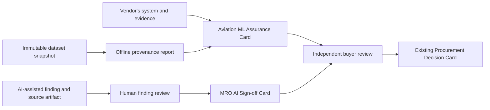

# Aerospace assurance extension | product one-sheet

**Status, 2026-10-12:** Local draft. No aerospace card endpoint, hosted tool, customer workflow, certification acceptance, or live buyer deployment was verified for this package. This is a vertical extension of the [Kinetic Gain Protocol Suite](../../../README.md).

**One line:** A common way to disclose an aviation ML system, carry a human review with an AI-assisted maintenance finding, and check the dataset evidence those disclosures point to.

| Required measure | Current evidence |
| --- | --- |
| Public aerospace repository count | Not measured. New repositories are under local review; count only after checking GitHub. |
| Verified live aerospace surfaces | Not measured. No aerospace live endpoint was checked. |
| Best winnable keyword difficulty | Not measured. Ahrefs was not refreshed. |
| Highest verified CPC | Not measured. Ahrefs was not refreshed. |

## What it is, three ways

**Technical.** The draft Aviation ML Assurance Card is vendor-authored JSON for one system version: intended use, declared EASA AI level, proposed target DAL, operating and excluded conditions, evidence references, data and learning posture, and the human role. The draft MRO AI Sign-off Card records one model finding, an exact-byte artifact digest, a human finding disposition, and an embedded Ed25519 signature. An offline Rust CLI hashes declared dataset files, flags exact-byte and supplied-group split leakage, evaluates an optional time split, counts validation/test samples by declared ODD bin, and can sign its deterministic report. A sourced crosswalk relates fields to public EASA, FAA, and NIST topics. A structural GitHub Action and five opt-in tools are proposed for the existing `mcp-kinetic-gain` server. Each component has a separate trust boundary.

**Simple.** A supplier says what its AI is meant to do and where it is meant to work. If the AI points to a maintenance finding, a person records what they decided about that finding. The data tool catches some obvious mistakes in the supplier's test data. A reviewer still has to check the actual evidence, the person's authority, and the applicable aviation process.

**Business problem.** An aircraft-system supplier, an AI inspection vendor, and a procurement team can exchange machine-readable statements without repeatedly translating prose into a spreadsheet. The format may shorten evidence intake and make missing links visible. Time saved, adoption, and willingness to pay have **not** been measured. A card cannot decide airworthiness, approve a DAL, establish compliance, or release an aircraft to service.

## How it works

1. The vendor writes a card for a specific model/system version and validates its JSON and semantic rules. A public `/.well-known/aviation-ml/<system_id>.json` address is a **proposed vendor-hosted convention**, not a deployed service here.
2. The dataset owner runs the Rust CLI on a controlled snapshot. The report lists observed hashes, leakage findings, time-split results when configured, and counts or gaps for the author's ODD bins. A trusted key can sign the report; the signer identity and custody still need outside controls.
3. An inspection workflow retains the original artifact and its exact-byte digest. A human records a decision about the **finding**; a trusted signer binds the card fields. Key identity, staff privileges, and record-control obligations are checked separately.
4. A buyer or reviewer checks source artifacts and authority in its own systems. The existing Procurement Decision Card can reference the aviation records. The crosswalk provides source context; it does not turn mapped fields into regulatory conformity.

The draft Action checks missing declarations in PRs. The proposed opt-in aviation tools belong to the **existing** MCP server, preserving the one-config-entry architecture after a separately reviewed release. The current public MCP package and any hosted Glama instance are not evidence that these draft tools are deployed.

## Buyer and use-case hypotheses

| Segment | Decision to improve | Plausible adoption path | Constraint |
| --- | --- | --- | --- |
| Civil aircraft or eVTOL system supplier | Prepare a consistent ML evidence intake packet | Export a vendor card from an existing assurance workflow | Applicant and authority determine the actual certification basis; card fields are declarations |
| AI inspection vendor and MRO buyer | Preserve model finding, exact artifact, and human disposition together | Attach a signed card to an internal finding record | Organisation procedures and authorised staff govern maintenance records and release |
| Drone OEM or operator | Describe bounded ML use and data coverage | Pilot the vendor card for a defined system version | UAS rule details and operating approvals must be checked for the specific case |

These are positioning hypotheses. There is no buyer, measured sales funnel, approved pilot, or production integration in the current evidence.

## SEO, GEO, and AEO opportunity

No keyword difficulty, search volume, CPC, or traffic potential was measured. The [keyword backlog](KEYWORD_OPPORTUNITIES.md) proposes queries to research before choosing search-led titles. The four [article drafts](content/) are education and developer-relations material tied to implemented local drafts and public primary sources; they make no ranking or demand claim.

## Four-article pipeline

| Draft | Reader and intent | Product connection | Proof needed before publication |
| --- | --- | --- | --- |
| [01: Versioned disclosure](content/article-01.md) | Vendor assurance lead seeking a shareable AI description | Aviation ML card fields and limitations | Public repo links and final schema review |
| [02: Maintenance finding sign-off](content/article-02.md) | MRO quality or engineering lead separating finding review from release | MRO card and signature profile | Legal/maintenance-process review for target jurisdiction |
| [03: Dataset leakage and ODD bins](content/article-03.md) | ML validation engineer checking a dataset snapshot | Rust CLI and reproducible report | Published tool and independent fixture reproduction |
| [04: Proposal-to-field mapping](content/article-04.md) | Assurance or procurement reviewer reading changing sources | Informative crosswalk | Source-status recheck at publication time |

## Alternatives and adoption friction

The present alternative is usually a supplier's document bundle, a spreadsheet checklist, a database, or an applicant's established assurance process. Those may already be appropriate. This extension adds stable machine-readable field names, explicit evidence pointers, and executable local checks. It introduces schema migration, signer-key governance, sensitive-record handling, and integration work. No competitor comparison or switching-cost estimate was performed.

## Release boundary

The local drafts use fictional examples and contain no aircraft records or defense technical data. The Action is structural, the crosswalk is informative, the CLI's pass flag covers only declared checks, and a cryptographic signature binds bytes rather than staff authority. Review and release each repository independently. Keep the public MCP extension behind its existing Glama private-build and access/privacy gate.
